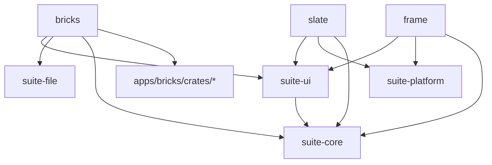

# Architecture overview

Cronkite is a Linux-native office suite written in Rust: Bricks, Slate, and Frame.

```text
Bricks — spreadsheet / CSV editor
Slate  — word processor: .txt, .md, .docx (docs/specs/slate.md, ADR 0003)
Frame  — presentation app (working name): .pptx (docs/specs/frame.md, ADR 0004)
```

## Guiding principle

> Share infrastructure, not product models prematurely.

Code becomes shared when at least two applications genuinely need the same abstraction. Until then it stays in the app that needs it. There is no universal document model.

## Structure

- **One monorepo, one Cargo workspace** (`Cargo.toml` at the root, one `Cargo.lock`). See [ADR 0001](../adr/0001-use-rust-monorepo.md).
- **Independently runnable applications** in `apps/`: `bricks`, `slate`, `frame`. Each is its own binary crate and builds and runs alone (`cargo run -p <app>`).
- **App-specific crates** live under their app: Bricks' engine is in `apps/bricks/crates/` (`csv-engine`, `formula`, `data-model`, `xlsx`, `grid`, `commands`, `file-format`, `jobs`). Their names describe what they do, not that they are shared: none of them is used by Slate or Frame.
- **Small shared infrastructure crates** in `crates/`:

| Crate | Purpose | Today |
| --- | --- | --- |
| `suite-core` | application-independent primitives: app identity, later common IDs, error and value types | `AppKind` with `display_name()` |
| `suite-ui` | UI conventions: later menus, command palette, toolbars, dialogs, themes, window chrome, shortcuts | `startup_message()` |
| `suite-platform` | OS integration, Linux first: later file dialogs, clipboard, desktop integration, drag and drop, Wayland/X11, system theme | `current()` platform check |
| `suite-file` | format-independent file infrastructure: later atomic writes, save/save-as, recent files, temp files, autosave and recovery | `document_name()` |

Format parsers (CSV, XLSX, DOCX, PPTX) never go in `suite-file`; they belong to the app that reads the format.

## Dependency direction



Rules:

- `suite-core` depends on no other workspace crate.
- `suite-ui`, `suite-platform`, and `suite-file` may depend on `suite-core` and nothing else in the workspace. Today only `suite-ui` needs it.
- No shared crate depends on an application or on an application's crates.
- An app's crates never depend on another app's crates. If two apps need the same code, it moves to a shared crate first.
- Apps depend only on the shared crates they use.
- Only apps, `suite-ui`, and `suite-platform` may depend on the GUI toolkit (see below).

## Errors and logging

- Libraries return errors for recoverable conditions instead of panicking. Error types are plain enums or structs implementing `std::error::Error` (for example `suite_platform::Unsupported`, Bricks' `SaveError`); no error framework.
- Binaries report startup errors on stderr as `<app>: <message>` and exit non-zero.
- Every app logs through [`tracing`](https://docs.rs/tracing) with a `tracing-subscriber` `fmt` subscriber writing to stderr (`INFO bricks: application starting`). There is no logging wrapper. Stdout stays free for program output: Bricks' benchmark modes report there.

## GUI toolkit

All three apps use GTK 4 through gtk4-rs, GTK 4.14 or newer ([ADR 0002](../adr/0002-gtk4-for-the-suite.md); Bricks' original evaluation is `apps/bricks/docs/decisions/0001-ui-toolkit.md`). `gtk` is declared once in `[workspace.dependencies]`. Apps may depend on it; `suite-ui` and `suite-platform` may once they hold code that needs it; `suite-core`, `suite-file`, and app engine crates never do. Bricks uses it today; Slate and Frame are still terminal scaffolds.

## Versions and editions

- Bricks and its crates share the workspace version (`[workspace.package] version`), which is Bricks' release version; `scripts/ship.sh bump` changes it. Slate, Frame, and the `suite-*` crates set their own versions.
- The workspace uses edition 2021. Moving to edition 2024 is a separate change.

## Future crates (speculative)

These are likely candidates, listed so the shape is visible. None exists yet, and not every one will become its own crate; each is created only when implementation work shows the need, and shared only when two apps need it.

| Area | Possible crates |
| --- | --- |
| Suite-wide | `text-engine`, `rendering`, `undo`, `commands`, `pdf-export`, `charts`, `tables` |
| Bricks | `bricks-model`, `csv-engine`, `xlsx` (the last two exist today as Bricks-only crates) |
| Slate | `document-model` and `docx` exist (`apps/slate/crates/`, SLATE-1 to SLATE-3) |
| Frame | `presentation-model`, `pptx` (planned by ADR 0004; built in FR0) |

Candidates already overlap with Bricks' own crates (`commands` holds Bricks' undo stack). Extracting one for the suite means generalizing it with a second app as its user, not moving it ahead of time.
